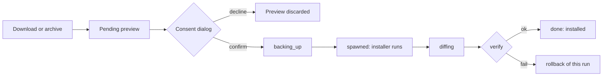

# Mod loaders

Some games need a mod loader in the game folder before any mod works. Stardew Valley needs SMAPI. A loader is not a mod: Vessel never stages it under `Mods/` or deploys it with your mods. It goes through its own flow:

1. Vessel shows you a plan.
2. You confirm it.
3. Vessel runs the plan, and tracks and backs up every game file the plan may change.

Vessel ships one loader: SMAPI for Stardew Valley.

## How it works

- **Where loaders appear.** The SMAPI card in Requirements shows SMAPI's state for the game:
  - not installed
  - installed (with version)
  - installed outside Vessel
  - changed since install (drifted)
  - busy

  Install, upgrade, repair, uninstall and adopt all start from that card.
- **Downloads never run anything.** A SMAPI archive can arrive from a browser `nxm://` link, a collection, an update check or a manual install. Vessel then only prepares a *pending preview*, and the SMAPI card in Requirements waits for you to review it. No installer runs, and no files change, until you confirm.
- **Preview.** Vessel caches the archive under `<data-dir>/loaders/archives/<sha256>/`, extracts it into a private scratch folder (mode 0700), makes that folder read-only and hashes it. The consent dialog then shows:
  - the operation (install, upgrade, repair, uninstall or adopt)
  - the SMAPI version
  - whether the game runs natively or under Proton
  - the exact command line, working folder and environment of each installer run
  - the game paths the run may touch
  - the changes outside the game folder
  - where the archive came from (verified or unverified)
  - any warnings
- **Run.** After you confirm, Vessel:
  1. re-checks the plan
  2. takes the deploy lock
  3. backs up the files in scope
  4. runs the installer
  5. compares the game folder before and after
  6. checks the result

  If any step fails, Vessel rolls back this run's changes to the game folder.



## Security model

### The installer runs with your user permissions

SMAPI's installer is a program from the SMAPI archive. Vessel runs it as you. It can read and write anything your user account can. **It is not sandboxed.** The consent dialog says this on every preview.

What Vessel does to limit and contain a run:

- **Clean environment.** The installer sees only:
  - `PATH` (`/usr/local/bin:/usr/bin:/bin`; under Proton, if `python3` is not in one of those folders, the first absolute folder in your `PATH` that holds it is added at the end)
  - `HOME`
  - `LANG` (`C.UTF-8`)
  - a private `TMPDIR` (`<data-dir>/loaders/tmp/preview-<id>/`)
  - under Proton, also `STEAM_COMPAT_DATA_PATH` and `STEAM_COMPAT_CLIENT_INSTALL_PATH`

  The consent dialog shows this exact environment: the run uses the same `TMPDIR` and `PATH` as the preview.

  Your Nexus API key and other Vessel secrets are never passed to it.
- **No input, captured output.** Stdin is empty. Stdout and stderr go to the run's log, capped at 8 MB.
- **Time limit.** After 5 minutes, Vessel kills the installer's whole process group. Under Proton it also stops the prefix's `wineserver`.
- **Dies with Vessel.** If Vessel exits during a run, the installer is killed.
- **Fixed program.** The installer runs from the read-only scratch copy. Its contents are hashed again right before it starts. Paths that leave the scratch folder or pass through a symlink are refused.

### Provenance

| Source | Result |
| :--- | :--- |
| Vessel downloaded it through the Nexus API, domain `stardewvalley`, mod `2400` | verified |
| Vessel downloaded it from a `Pathoschild/SMAPI` GitHub release (asset `SMAPI-*.zip`, tag equal to the archive's version) | verified |
| Anything else (a file you picked from disk, another Nexus mod, another GitHub repo) | unverified |

- **Unverified archives** can run only if you explicitly accept the warning in the consent dialog. That acceptance is part of the plan Vessel hashes, so it cannot be added later.
- **The layout check always applies.** The archive must hold exactly one `SMAPI <version> installer/` folder, with `internal/linux/SMAPI.Installer`, `internal/windows/SMAPI.Installer.exe`, and an `install.dat` for each platform. Each `install.dat` must be a zip that contains `StardewModdingAPI.dll`, and its version must match the folder's. Any mismatch is a hard reject (`loader_layout_mismatch`), whatever the source.

### Consent

- Every operation that starts an installer needs a preview and its plan hash. This covers install, upgrade, repair, uninstall and adopt.
- A preview is used once and expires after 10 minutes.
- The hash covers:
  - the plan
  - the runtime
  - the archive's SHA-256
  - the scratch folder's contents
  - your unverified-source acceptance
  - the operation, game and loader
  - the game folder
  - your `PATH`, as stored at preview
- If anything changes between preview and run, the run is refused with `loader_consent` before anything runs, and you review it again. This includes the cached archive used by repair.
  - Game folder changed (for example, the game was moved): `the game folder changed after the preview`.
  - Extracted installer changed: `the extracted installer changed after the preview`.
- The extracted installer is hashed once more right before it starts, after backups and other steps. A change at that point does not return `loader_consent`: the run fails, its changes are rolled back, and the reason is `the extracted installer changed after the preview`.
- Reopening a pending preview fails with `the cached loader archive changed` if the cached archive no longer matches its SHA-256.
- Browser links, collections, update checks and auto-deploy create pending previews only. They never run an installer.

### What is backed up

- **Before each run**, Vessel copies every existing file in the plan's touch scope into its backup store, `<data-dir>/backups`. It never hardlinks them. It also saves a manifest of the scope. The touch scope covers:
  - `StardewValley` and `StardewValley-original`
  - `StardewModdingAPI*`
  - `smapi-internal/**` (including your `config.user.json`)
  - `steam_appid.txt`
  - `*.deps.json`
  - `unix-launcher.sh`
  - SMAPI's list of obsolete files
  - `Mods/ConsoleCommands/**`, `Mods/SaveBackup/**`, `Mods/.cache/**`, `Mods/ErrorHandler/**` and `Mods/TrainerMod/**`
  - any folder under `Mods/` whose `manifest.json` declares `SMAPI.ConsoleCommands` or `SMAPI.SaveBackup`
- **Your other mods** under `Mods/` are not in scope.
- **The first run's manifest** is the install's vanilla baseline. It is kept even when old logs are pruned.
- **Mod conflicts.** If a mod Vessel deployed owns a file in scope, the run is blocked with `loader_conflict`.
- **Steam settings.** Applying launch options first saves Steam's settings file as `localconfig.vdf.vessel-bak`, next to the original.

### Changes Vessel cannot undo

SMAPI's installer also changes files outside the game folder. Vessel lists these in the consent dialog as unrecoverable, and cannot roll them back:

| Change | Native | Proton |
| :--- | :--- | :--- |
| Moves `Saves/.smapi` to `.smapi` (deletes the old one if both exist) | `~/.config/StardewValley/` | `<compatdata>/pfx/drive_c/users/steamuser/AppData/Roaming/StardewValley/` |
| Deletes `ErrorLogs` | `~/.config/StardewValley/ErrorLogs` | same folder in the prefix |
| Leaves an extracted installer copy (about 40 MB) | the run's private temp folder | `<compatdata>/pfx/drive_c/users/steamuser/AppData/Local/Temp/SMAPI-installer-*` |

Vessel's cleanup at startup removes the leftover installer copies. Copy your `StardewValley/Saves` folder before your first install if you want a safe copy of it.

### Logs

- **Location.** Each run keeps its logs in `<data-dir>/loaders/runs/<id>/` (`step-N.log`, `pre.json`, `scope.json`).
- **Retention.** For each install, Vessel keeps the logs of the last 20 runs that are younger than 90 days. Logs of failed, timed-out or interrupted runs are always kept.
- **Redaction.** When Vessel shows or exports a log, it redacts API keys, tokens, passwords, `Bearer` values and long key-like strings, and replaces your home folder with `~`.

## SMAPI: native and Proton

Vessel runs SMAPI's own installer binary directly, with `--install` or `--uninstall`, then `--no-prompt --game-path <game folder>`. It does not use `install on Linux.sh` or `install on Windows.bat`: neither script passes these arguments to the installer, and both only work interactively.

The installer's exit code is not trusted, because it returns 0 on some errors. Success is decided by checking the game folder afterwards.

### Native (Linux build)

- **Command.** `<scratch>/SMAPI <ver> installer/internal/linux/SMAPI.Installer --install --no-prompt --game-path <game folder>`.
- **Game files.** In the vanilla game, `StardewValley` is a bash launcher script, and the game binary (ELF) is `Stardew Valley`.
- **What a successful install leaves:**
  - `StardewValley` is SMAPI's launcher.
  - `StardewValley-original` is the vanilla launcher script.
  - `StardewModdingAPI`, `StardewModdingAPI.dll` and `smapi-internal/` exist.
  - `Mods/ConsoleCommands` and `Mods/SaveBackup` exist.
- **File modes.** The installer does not wait for its own `chmod`, so after it exits Vessel sets mode 755 on `StardewValley` and `StardewModdingAPI`.
- **No launch options.** Steam starts `StardewValley`, which is now SMAPI's launcher.
- **What a successful uninstall leaves:** no SMAPI files and no `StardewValley-original`, `StardewValley` is the vanilla script again, and `Stardew Valley` is an ELF. Vessel then restores, from its backups, anything else the run changed in scope (such as `steam_appid.txt`).

### Proton (Windows build)

- **Command.** `<scratch>/SMAPI <ver> installer/internal/windows/SMAPI.Installer.exe`, run as `<proton> run`, with the game path in Wine form (`Z:\...`).
- **Steam Linux Runtime.** If the Proton version requires one, the command is wrapped in the runtime's `run` script, as Steam does.
- **Which Proton.** Vessel uses the game's Proton mapping from Steam, or the global default when Steam has no mapping for the game. Under a runtime override it does the same. The `proton` file must:
  - be inside `steamapps/common/*` of a Steam library, or `compatibilitytools.d/*`
  - be owned by you or root
  - not be writable by group or others
- **Before the run:**
  - The game's prefix must exist. Start the game once from Steam.
  - If the prefix was last used by a different Proton, Vessel warns you.
- **What a successful install leaves:** `StardewModdingAPI.dll`, `StardewModdingAPI.exe` and `smapi-internal/`.
- **Launch options.** Steam must start SMAPI instead of the game:

  ```text
  "Z:\<game folder, with \ separators>\StardewModdingAPI.exe" %command%
  ```

  See [Launch options](#launch-options).
- **Uninstall** removes the SMAPI files and clears the launch options Vessel needs.

### How Vessel tells native from Proton

1. Your runtime override for the game, if you set one.
2. A Steam compatibility tool mapped to the game means Proton.
3. An ELF file at the game root means native.
4. A Windows `.exe` means Proton, with Steam's default tool.

If none of these applies, you get `loader_unknown_runtime` and pick native or Proton yourself.

### Checks before every run

| Check | Error |
| :--- | :--- |
| No process runs from the game folder | `loader_game_running` |
| Steam reports the game fully installed, with no update pending | `loader_not_fully_installed` |
| The runtime is known | `loader_unknown_runtime` |
| No Vessel-deployed mod owns a file in scope | `loader_conflict` |
| Proton: Vessel is not a Flatpak | `loader_flatpak_unsupported` |
| Proton: Steam is not the Flatpak | `loader_flatpak_steam_unsupported` |
| Proton: the prefix exists | `loader_prefix_missing` |
| Proton: the tool is mapped and installed, and passes the trust checks | `loader_no_compat_tool`, `loader_compat_tool_missing`, `loader_proton_untrusted` |
| Proton: the required Steam Linux Runtime is installed | `loader_slr_missing` |

## Launch options

When the loader needs Steam launch options (SMAPI under Proton), the SMAPI card shows the exact string. You set it in one of two ways.

### Copy and acknowledge (default)

1. Copy the string.
2. Paste it into Steam: the game's Properties > General > Launch Options.
3. Tell Vessel you set it. Vessel records the string you acknowledged.

If the needed string changes later, the card shows the mismatch again.

### Apply

Vessel writes the value into Steam's `userdata/<account>/config/localconfig.vdf`. It changes only `UserLocalConfigStore > Software > Valve > Steam > apps > <appid> > LaunchOptions`, and keeps every other byte of the file.

- **Account.** With one Steam account, Vessel uses it. With several, Vessel asks you to pick one and preselects the most recent: the account Steam marks `MostRecent`, or else the newest `timestamp` in `loginusers.vdf`.
- **Steam must be closed.** Steam rewrites the file from memory when it exits, so Apply refuses while Steam runs (`launch_steam_running`). It checks again right before it replaces the file.
- **Safe write.** Vessel saves a backup copy (`localconfig.vdf.vessel-bak`), writes to a temp file and renames it into place. If the file changed in the meantime, nothing is written (`launch_changed`).
- **After uninstall.** Apply clears the value Vessel wrote earlier. It refuses to clear a value it did not write (`launch_nothing_to_apply`).

## After a Steam update or file verify

Steam's "Verify integrity of game files", and some game updates, put the vanilla `StardewValley` back over SMAPI's launcher.

- **Detection (native).** The SMAPI card shows SMAPI as changed since install, with the reason "StardewValley is no longer SMAPI's launcher". It does the same when `StardewModdingAPI.dll` is missing.
- **Detection (Proton).** Vessel checks for `StardewModdingAPI.dll`.
- **Fix.** Run repair from the SMAPI card. Repair reuses the cached archive, after checking its SHA-256 against the one recorded at install.
- **What repair does with `StardewValley`.** Before repair, upgrade or uninstall, Vessel hashes the current `StardewValley`:

  | Current file | Meaning | Action |
  | :--- | :--- | :--- |
  | SMAPI's launcher | intact | none |
  | the recorded vanilla file | same vanilla as before | warning only |
  | anything else | Steam updated the game | the new file becomes the vanilla backup, and `StardewValley-original` is refreshed from it |

  The vanilla file you had before the first install is never replaced with SMAPI content.
- **If uninstall finds a non-vanilla launcher**, it stops with `loader_verify_failed_steam`. Verify the game files in Steam, then try again.

## Adopt a manual install, and clean up junk

### Adopt

- **Detection.** Vessel looks for `StardewModdingAPI.dll` or `StardewValley-original` without a Vessel record. When it finds one, the SMAPI card shows SMAPI as installed outside Vessel, and an install attempt returns `loader_manual_install_detected`, with the action to adopt.
- **Start.** Download SMAPI through Vessel. The pending preview becomes an adopt.
- **What adopt does:**
  1. Runs the installer with `--uninstall`.
  2. Checks that the game is vanilla again. If it is not, it stops.
  3. Runs `--install` as a managed install.

From then on, Vessel tracks SMAPI like any install it made.

### Junk cleanup

Older versions could stage a SMAPI installer archive as a mod. Vessel finds mod rows whose staged files match a loader archive and offers to remove them. Removal:

1. Purges the deployment.
2. Deletes those mod rows and their staged folders.
3. Redeploys your other mods.

Only the rows Vessel reported are touched.

## Interrupted runs and rollback

- **Failed run.** If the installer fails, times out or does not pass the check, Vessel rolls the game folder back to its state before the run. The run's log is kept.
- **Crash during a run** (for example a power loss). On the next start, Vessel handles the run by phase:
  - Crashed while backing up: the run is discarded. The game was not touched.
  - Crashed while the installer ran: Vessel kills the stored process group, but only if it is still the same processes. It then records what changed and offers a rollback.
  - Crashed while comparing: Vessel finishes the comparison and offers a rollback.
- **The rollback offer.**
  - Accept: tracked files are restored from backups.
  - Decline: the files stay as they are, and the install counts as installed.
- **No re-runs.** Recovery and rollback never start an installer.
- **Outside the game folder.** Rollback cannot undo the changes listed in [Changes Vessel cannot undo](#changes-vessel-cannot-undo).

## Flatpak limits

| Setup | Native SMAPI | Proton SMAPI |
| :--- | :--- | :--- |
| Vessel from a distro package or AppImage, Steam native | supported | supported |
| Vessel as a Flatpak (`org.vessel.app`) | runs inside the Flatpak sandbox | refused: `loader_flatpak_unsupported` |
| Steam as a Flatpak (`com.valvesoftware.Steam`) | supported | refused: `loader_flatpak_steam_unsupported` |

- **Why Proton is refused under Flatpak Vessel.** The sandbox cannot start Proton inside the Steam Linux Runtime.
- **Which game folders Flatpak Vessel can reach.** Only the folders it is granted:
  - `~/.local/share/Steam`
  - `~/.steam`
  - the Flatpak Steam data folder
  - `/run/media`, `/media` and `/mnt`

## Errors and actions

Each error has a code. The interface maps each code to a title and one suggested action. The codes and actions are fixed: `apps/desktop/src/ipc/loaderErrorCodes.json`, `apps/desktop/src/ipc/loaderErrors.ts`.

| Action | Meaning |
| :--- | :--- |
| `retry` | Fix the cause, then try again |
| `pick_runtime` | Choose native or Proton for the game |
| `close_game` | Close the game |
| `verify_files` | Verify the game files in Steam |
| `adopt` | Adopt the manual install |
| `open_log` | Open the run's log |
| `open_settings` | Open Vessel's settings |
| `none` | No direct action |

| Code | Title | Action |
| :--- | :--- | :--- |
| `loader_conflict` | Files already in use | `none` |
| `loader_archive_required` | Loader download needed | `retry` |
| `loader_payload` | Loader definition problem | `open_log` |
| `loader_unsafe_path` | Unsafe file path | `open_log` |
| `loader_unsafe_for_cmd` | Unsafe installer argument | `open_log` |
| `loader_manual_install_detected` | Loader installed outside Vessel | `adopt` |
| `loader_ambiguous_match` | Unclear loader archive | `none` |
| `loader_duplicate_key` | Loader listed twice | `open_log` |
| `loader_unknown_loader` | Unknown loader | `none` |
| `loader_no_compat_tool` | No Proton version chosen | `open_settings` |
| `loader_compat_tool_missing` | Proton not found | `open_settings` |
| `loader_proton_untrusted` | Proton not trusted | `open_log` |
| `loader_slr_missing` | Steam Linux Runtime missing | `retry` |
| `loader_flatpak_unsupported` | Not available in the Flatpak | `none` |
| `loader_flatpak_steam_unsupported` | Flatpak Steam not supported | `none` |
| `loader_game_running` | Game is running | `close_game` |
| `loader_not_fully_installed` | Game needs an update | `retry` |
| `loader_prefix_missing` | Game not started yet | `retry` |
| `loader_unknown_runtime` | Native or Proton? | `pick_runtime` |
| `loader_host_mismatch` | Installer not supported here | `none` |
| `loader_spawn` | Installer did not start | `open_log` |
| `loader_layout_mismatch` | Not a valid loader archive | `none` |
| `loader_verify_failed` | Loader step did not finish | `open_log` |
| `loader_verify_failed_steam` | Game files changed | `verify_files` |
| `loader_consent` | Plan changed | `retry` |
| `loader_already_installed` | Already installed | `none` |
| `loader_not_installed` | Not installed | `none` |
| `loader_store` | Database error | `open_log` |
| `loader_io` | File error | `open_log` |
| `launch_conflict` | Launch options conflict | `none` |
| `launch_invalid` | Invalid launch options | `none` |
| `launch_steam_running` | Steam is running | `retry` |
| `launch_changed` | Steam settings changed | `retry` |
| `launch_no_account` | No Steam account | `retry` |
| `launch_unknown_account` | Unknown Steam account | `open_settings` |
| `launch_nothing_to_apply` | No launch options needed | `none` |
| `launch_unknown_game` | Unknown game | `none` |
| `launch_vdf` | Cannot read Steam settings | `open_log` |
| `launch_store` | Database error | `open_log` |
| `launch_io` | File error | `open_log` |

The manual test procedure is in [loaders-smoke-test.md](loaders-smoke-test.md).
